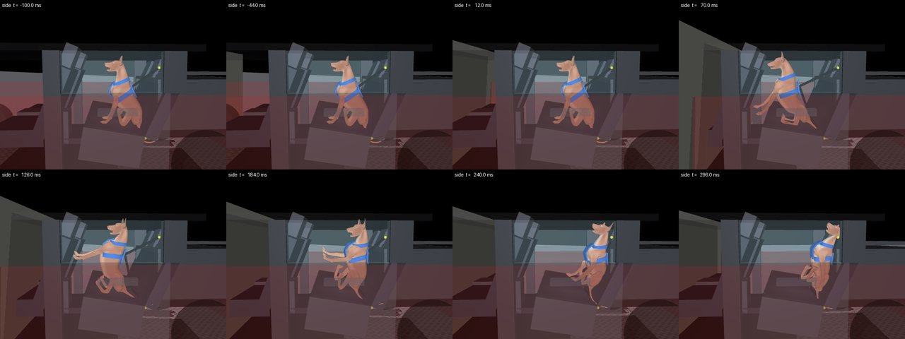
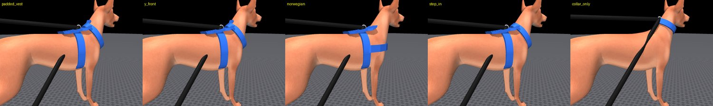
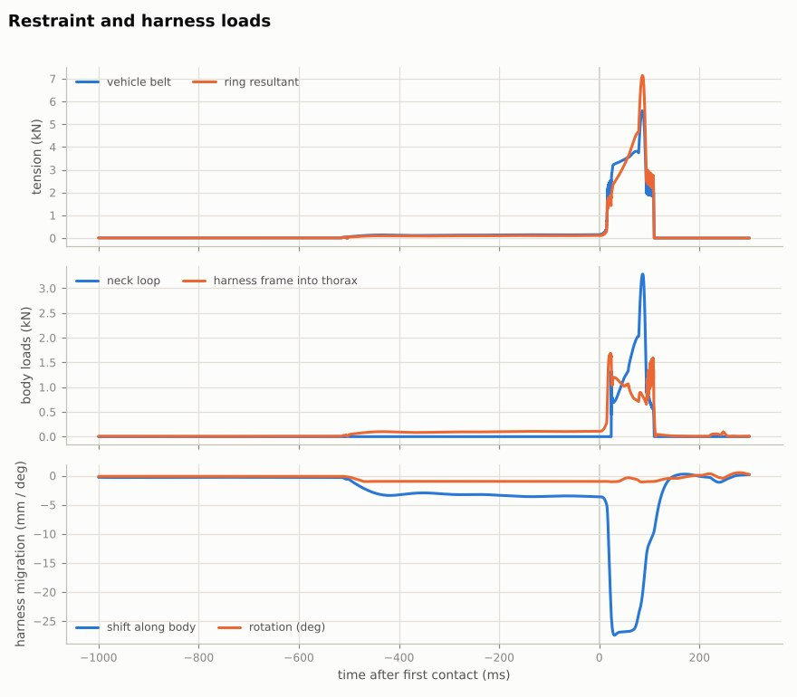

# Musculoskeletal Dog

This repository contains the MuJoCo musculoskeletal dog models (below) and **`dog_crash_sim`**, an
application that uses them to simulate car crashes and test the safety of **rear-seat dog harnesses**.

* [Rear-seat harness crash simulator](#rear-seat-harness-crash-simulator)
* [The dog models](#the-dog-models)

---

## Rear-seat harness crash simulator

<p float="left">
  
</p>

`dog_crash_sim` crashes a car, puts a scalable 3D musculoskeletal dog wearing a parametric 3D harness
on the rear seat, and reports what the harness, the vehicle restraints and the dog's body experience.

```bash
pip install -e .                 # mujoco, numpy, pyyaml, matplotlib, pillow
python -m dog_crash_sim presets  # standard test configurations
python -m dog_crash_sim run cps_sled_frontal
python -m dog_crash_sim run scenarios/frontal_sedan_belt_loop.yaml --set collision.impact_speed_kph=40
python -m dog_crash_sim sweep frontal_full_width_56 --param harness.style \
    --values padded_vest,y_front,norwegian,step_in,collar_only
python -m dog_crash_sim template -o my_test.yaml   # every parameter, documented
python -m dog_crash_sim params                     # table of all parameters with units
```

Each run writes a folder with `report.html` (verdict, criteria table, plots, key frames, every input
parameter), `summary.json`, `timeseries.csv` (1 kHz), the full-rate channels (`channels.npz`), the
vehicle motion and replay states. `--render` adds slow-motion videos (`side`, `dog`, `top`, `front`,
`world` cameras); `python -m dog_crash_sim view <results>` replays a run in the interactive MuJoCo
viewer and `python -m dog_crash_sim render <results>` renders videos afterwards. Off-screen rendering
needs OpenGL: a display, `MUJOCO_GL=egl` / `osmesa`, or `xvfb-run -a python -m dog_crash_sim ...`.
Without it the simulation and report still work; only the key-frame image is skipped.

### The test variables

A scenario is a YAML/JSON file (or a preset plus `--set key=value` overrides). Its sections map onto
the six test categories; `python -m dog_crash_sim params` lists every field.

| Category | Section | Variables |
|---|---|---|
| **Collision** | `collision` | `impact_speed_kph`, `impact_direction` (frontal/rear/left/right), `impact_angle_deg`, `overlap` + `overlap_side`, `impact_location_m`, `partner` (`rigid_barrier`, `deformable_barrier`, `pole`, `vehicle`, `moving_barrier`, `truck`: mass, speed, width, stiffness, crush force/depth, ride height, engaged face). `mode: sled` replaces the crash by a sled pulse (FMVSS 213-like, half-sine, trapezoid or CSV). |
| **Vehicle** | `vehicle` | `mass_kg`, `length_m`, `width_m`, `height_m`, `wheelbase_m`, `track_m`, CG position, inertias; `structure` (front/rear/side/compartment stiffness, unloading, ride height, rail and pillar shares); `crush_zones_front/rear/side` (depth + crush force per zone); `rear_compartment` (seat bight, cushion, seat-back recline and height, front-seat position, floor, roof, cabin width, door crush space, C-pillar, trunk length/height/floor, parcel shelf, open sled buck). Presets: `midsize_sedan`, `compact_hatchback`, `midsize_suv`, `station_wagon`, `minivan`, `pickup_crew_cab`. |
| **Rear passenger** | `rear_passenger` | the dog: `breed_size` (toy ... giant, CPS 25/45/75 lb dummies) or `mass_kg` + `withers_height_m`; `seating_position` (rear left/center/right, foot well, cargo area); `posture` (sitting, lying sternal, lying lateral, standing) and `facing_deg`; `seat_belt_used` (harness connected or the dog travels unrestrained); `neuromuscular` (muscle tone, startle reflex and its latency, stretch reflex, activation time, ligament stiffening); `mass_distribution`. |
| **Restraints** | `restraints` | `attachment` (belt threaded through the harness loop, tether into the buckle, ISOFIX Y-tether, head-restraint tether, cargo-hook tether); `belt` geometry (upper anchor, buckle, lap anchor, ISOFIX spacing, webbing stretch, slack, retractor locking, film spool); `pretensioner` (retractor/buckle, firing logic, stroke, force, speed); `load_limiter`; `airbags` (curtain, rear side thorax, front-seat-back, rear centre - deployment timing, pressure, venting); `seat` (cushion stiffness/damping/friction, seat-back stiffness, yield moments, latch strength, mass, trim softness); `head_restraints` (presence, height, width, thickness, offset, softness). |
| **Trunk / cargo** | `trunk_cargo` | `items` (name, `mass_kg`, `size_m`, `position_m`, yaw, friction, rigid/soft), `packing` (against the seat back, stacked, side by side, loose at the rear, custom), `restraint_method` (none, tie-down straps, cargo net, cargo barrier/dog guard, locked floor box) with strap/net/barrier stiffness and strength. |
| **Environment** | `environment` | `road_condition` / `road_friction`; `braking` (enable, demanded deceleration, onset before impact, ramp, ABS, continue after impact); `motion` before impact (initial yaw rate, sideslip, evasive steering angle/onset/ramp); pre-impact duration. |

The device under test is described in `harness` (style, attachment point, strap width and strength,
chest-plate area, padding, fit, buckle and D-ring strength, mass, colour, optional STL of your own
design for display, and the `tether`: length or slack, stretch, strength, connector, tear-webbing
energy absorber). `assessment` holds the criteria settings; `simulation` the numerics and rendering.

### How it works

1. **Vehicle crash model** (`vehicle/crash_model.py`). The car is a rigid body in the road plane with
   pitch/roll suspension modes. Before impact it is driven by friction-limited tyres (braking with or
   without ABS, cornering, evasive steering, initial yaw and sideslip); the initial speed is solved so
   the impact happens at the requested speed. The crash interface is a pair of elasto-plastic crush
   characteristics in series (the car's crush zones and the partner's face) with loading history and
   elastic spring-back. How much structure is engaged depends on overlap, pole width, rail and pillar
   positions and ride-height mismatch; the force acts at the engaged centroid, so offset/oblique impacts
   yaw the car, and partial-overlap impacts can glance off. Side and rear crush beyond the door/trunk
   crush space become door and trunk-wall intrusion at the dog's row.
2. **Occupant model** (`simulation.py`). MuJoCo simulates the dog, harness, seat back, cargo, airbags
   and intruding trims in the vehicle frame at 10 kHz. The car's translational acceleration enters as a
   modified gravity vector and its rotation as Euler, centrifugal and Coriolis loads on every body, so
   accelerations reported for the dog are true inertial values.
3. **Dog biophysics** (`biophysics/`). The model in `musculoskeletal_dog/models/dog.xml` is rescaled
   allometrically to the requested mass and withers height (lengths, masses, inertias, skin, joint
   stiffness/damping and muscle torque capacity), with segment masses redistributed to canine segment
   fractions. 38 lumped Hill-type muscle groups provide postural tone, a delayed startle/bracing reflex
   and a spinal stretch reflex with activation dynamics and force-velocity weakening; ligaments and
   joint capsules add exponentially stiffening torques near the joint limits; a torque-limited balance
   term stands in for whole-body postural balance before the crash.
4. **3D harness** (`scene/harness.py`). The harness is a light rigid frame (back pad, girth band, chest
   plate, attachment ring) on a six-axis bushing to the thorax whose travel and stiffness represent the
   fit, plus tension-only webbing straps routed over the neck (C7), the points of the shoulders and the
   prosternum. Strap visuals are generated from cross-sections of the dog's skin so they fit any dog
   size. Styles: `padded_vest`, `y_front`, `norwegian`, `step_in` and a `collar_only` reference.

   

5. **Restraints** (`restraints/models.py`). Webbing with hysteresis and breaking strength, retractor
   locking and film spool, pyrotechnic pretensioner, load limiter, tear-webbing energy absorbers,
   elasto-plastic seat back with a breakable latch, airbag deployment/venting, cargo straps, nets,
   barriers and locked boxes that can fail.
6. **Assessment** (`analysis/injury.py`). SAE J211 filtering, HIC15, 3 ms clips, upper/lower neck
   forces, moments and Nij, thoracolumbar compression, estimated thoracic compression and VC,
   joint motion beyond the physiological range, throat (tracheal) strap load, strap/plate contact
   pressure, tether/connector/ring/strap/buckle loads against rated strength with a safety factor, head
   excursion towards the nearest interior surface, lateral excursion, torso rotation, harness shift and
   rotation (escape risk), whether the dog stays on its seat, cargo striking the dog and seat-back
   collapse. Each criterion is rated good / acceptable / marginal / poor; an injury index (mean worst
   ratio per body region) ranks designs in sweeps.

   

### Limits of the model - read before using results

* **There are no validated injury criteria for dogs.** Biomechanical limits are human reference values
  (Hybrid III 50th male, FMVSS 208 / NHTSA Nij) transferred by geometric similitude with the mass ratio.
  Strap-pressure and throat-load limits are screening values. All thresholds can be overridden in
  `assessment.overrides`. Use the simulator first of all to **compare** harness designs, attachments and
  vehicle configurations under identical conditions.
* The vehicle model is a lumped-parameter crash model, calibrated only to typical published pulse
  shapes (e.g. ~35 g / 0.65 m crush for a 56 km/h full-width impact). For a specific car, fit the crush
  zones to its test data, or use `collision.mode: sled` with a measured pulse (`sled.shape: csv`).
* The dog's soft tissue is represented by rigid collision primitives; thoracic compression is
  estimated from the loads on the thorax with a scaled viscoelastic chest, not measured.
* Strap migration is captured by the harness bushing (shift and rotation, with limits) rather than by
  straps sliding over the skin, and the vehicle belt's lap section is buckled but does not load the dog.
* The dog's placement is checked against the interior; postures that do not fit (e.g. a giant dog
  sitting upright under a sedan roof) are rejected with an explanation, and small adjustments (head
  turned towards the gap between the front seats or lowered) are reported in the run notes.

### Package layout

```
dog_crash_sim/
├── config.py            # scenario schema: every variable, unit and description
├── presets.py           # standard crash-test configurations
├── vehicle/             # vehicle crash dynamics and crash pulses
├── biophysics/          # dog scaling, postures, neuromuscular and passive tissue models
├── scene/               # rear-compartment layout, 3D harness, MuJoCo scene builder
├── restraints/          # webbing, retractor, pretensioner, load limiter, seat back, airbags
├── simulation.py        # occupant simulation in the vehicle frame
├── analysis/            # signal processing and injury / performance assessment
├── report.py, render.py # HTML report, figures, videos, replay
└── cli.py               # command-line application
scenarios/               # example scenario files and the fully commented template
tests/                   # pytest suite (python -m pytest)
```

---

## The dog models

<p float="left">
  
   
  
  
</p>

This repository contains 3 MuJoCo models of a dog:
1. Entirely torque based.
2. Musculoskeletal model using Millard's dynamics
3. Musculoskeletal model using a sigmoid function for activation/deactivation dynamics.

The muscle model:

<p float="left">
  
</p>

Example of the dog used in simulation:

<p float="left">
  
</p>

## Contents

Following the [MuJoCo Menagerie](https://github.com/google-deepmind/mujoco_menagerie) convention, each
dog model is standalone (no floor, no lights, no skybox) so it can be dropped into your own scene, and
is paired with a `scene*.xml` that adds the ground plane and lighting for stand-alone viewing.

| Model | Scene | Description |
| --- | --- | --- |
| [`dog.xml`](musculoskeletal_dog/models/dog.xml) | [`scene.xml`](musculoskeletal_dog/models/scene.xml) | Torque-actuated (38 actuators) |
| [`dog_muscles_Millard.xml`](musculoskeletal_dog/models/dog_muscles_Millard.xml) | [`scene_muscles_Millard.xml`](musculoskeletal_dog/models/scene_muscles_Millard.xml) | Muscle-actuated (127 muscles), Millard dynamics |
| [`dog_muscles_Sigmoid.xml`](musculoskeletal_dog/models/dog_muscles_Sigmoid.xml) | [`scene_muscles_Sigmoid.xml`](musculoskeletal_dog/models/scene_muscles_Sigmoid.xml) | Muscle-actuated (127 muscles), sigmoid activation dynamics |

```
musculoskeletal_dog/
├── models/          # the three dog models and their scenes
└── assets/
    ├── meshes/      # bone meshes (STL)
    ├── skins/       # muscle skins (SKN)
    └── textures/
```

## Loading the model

### Viewer

The quickest way to look at the model is the interactive viewer that ships with the MuJoCo Python
package:

```bash
pip install mujoco
python -m mujoco.viewer --mjcf=musculoskeletal_dog/models/scene.xml
```

Alternatively, download the MuJoCo release from the
[releases page](https://github.com/google-deepmind/mujoco/releases) and drag any of the `scene*.xml`
files onto the `simulate` binary (see
[Getting Started](https://mujoco.readthedocs.io/en/latest/programming/#getting-started)).

### Python

```python
import mujoco

model = mujoco.MjModel.from_xml_path("musculoskeletal_dog/models/scene.xml")
data = mujoco.MjData(model)

while data.time < 1.0:
    mujoco.mj_step(model, data)
```

### Using the dog in your own scene

Include the bare model and provide your own floor, lights and skybox:

```xml
<mujoco model="my scene">
  <include file="path/to/musculoskeletal_dog/models/dog.xml"/>

  <worldbody>
    <light pos="0 0 3" dir="0 0 -1" directional="true"/>
    <geom name="floor" type="plane" size="10 10 0.1"/>
  </worldbody>
</mujoco>
```

The models reference their meshes, skins and textures by paths relative to the model file itself
rather than through `meshdir`/`texturedir`. MuJoCo drops an included file's `meshdir` but resolves its
relative asset paths against that file's own directory, so the include above works from any location —
including one where your own model declares a different `meshdir`. Just keep `models/` and `assets/`
in their relative positions.

## License

Released under the [MIT License](LICENSE).

## Citation

If you use this model in your research, please cite:

> V. La Barbera, S. Bohez, L. Hasenclever, Y. Tassa, and J. R. Hutchinson,
> "Motion Tracking with Muscles: Predictive Control of a Parametric Musculoskeletal Canine Model,"
> arXiv:2506.23768, 2025. https://arxiv.org/abs/2506.23768

```bibtex
@article{labarbera2025motion,
  title   = {Motion Tracking with Muscles: Predictive Control of a Parametric
             Musculoskeletal Canine Model},
  author  = {La Barbera, Vittorio and Bohez, Steven and Hasenclever, Leonard and
             Tassa, Yuval and Hutchinson, John R.},
  journal = {arXiv preprint arXiv:2506.23768},
  year    = {2025},
  url     = {https://arxiv.org/abs/2506.23768}
}
```
